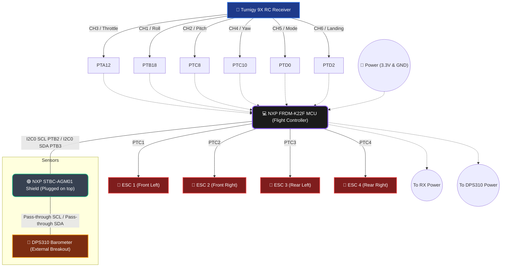

# Quadcopter Hardware Wiring Diagram

Here is a visual map of all hardware components connected to the FRDM-K22F Flight Controller! 

> [!TIP]
> **Grounding is Critical**
> Ensure the Ground (GND) wire from your RC Receiver and the DPS310 are both connected back to the FRDM-K22F. The ESCs should also share a common ground with the flight controller if they are powered from a separate battery.
